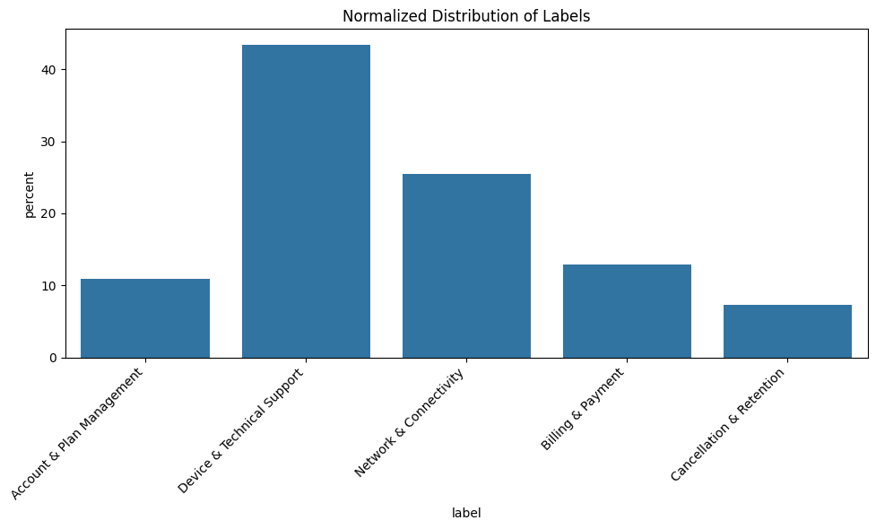
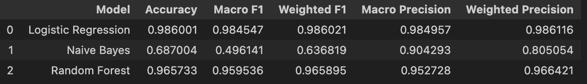
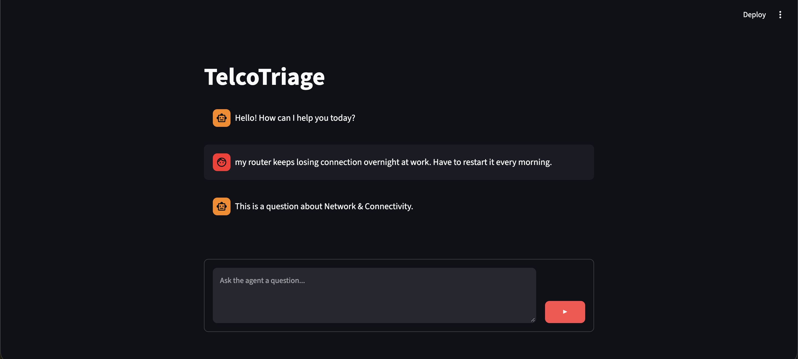

# TelcoTriage: Automated Support NLP Agent

### 👥 **Team Members**

| Name             | GitHub Handle | Main Contributions                                                       |
|------------------|---------------|--------------------------------------------------------------------------|
| Favour Aina      | @NifemiF      | Text normalization, model training, metrics comparison                   |
| Dian Tang        | @afkdiann     | AI agent creation, data cleaning, project documentation                  |
| Alana Taylor     | @alana-tay1or | AI agent validation, data visualization, exploratory data analysis (EDA) |

---

## 🎯 **Project Highlights**

- Trained a classification + natural language processing (NLP) machine learning model using logistic regression to address customer satisfaction.
- Achieved a model accuracy of ~0.98, supporting Verizon's commitment to enhance user experiences in a rapidly evolving digital world. 
- Developed an LLM-powered agent that exposes the logistic regression model to customers and allows for interactivity. 
- Implemented the agile methodology (by leveraging GitHub Projects) to address industry constraints or expectations.

---

## 👩🏽‍💻 **Setup and Installation**
### Prerequisites
* [Miniconda](https://www.anaconda.com/docs/getting-started/installation) 26.9.4
* [Ollama](https://ollama.com/download) (qwen3:1.7b model)

### Installation
1. Clone the repository:

    ```
    git clone https://github.com/Break-Through-Tech/Telecom-1B-automated-telecom-support-nlp-agent-for-incident-management
    cd Telecom-1B-automated-telecom-support-nlp-agent-for-incident-management
    ```

2. Set up project environment:

    ```
    conda create -n smolagents_env python=3.10 -y
    conda activate smolagents_env
    ```

3. Install dependencies:

    ```
    pip install -r requirements.txt
    ```

4. Download the Ollama model locally:
    
    ```
    ollama pull qwen3:1.7b
    ```

5. Run the AI agent:

    ```
    python -m streamlit run src/app.py
    ```

---

## 🏗️ **Project Overview**
As part of our AI Studio Project for the Break Through Tech AI Program, we were paired with Verizon as our host company. We were tasked with training a classification + NLP model and wrapping an AI agent around it to resolve/escalate customer issues.

Our goals included:
* Having a model accuracy of at least 70%.
* Creating a visually appealingly UI for the agent's output. 
* Adding additional functionality if possible.

If successful, our AI agent will help Verizon significantly improve customer satisfaction rates and provide quick, accurate solutions for customer service problems.

---

## 📊 **Data Exploration**
The original dataset can be accessed at: https://www.kaggle.com/datasets/thoughtvector/customer-support-on-twitter.
It contains ~2.8 million examples, but our Challenger Advisor filtered it for telecom companies and added the label column.

### Additional preprocessing:
* Dropped tweets belonging to the 'General / Other' category and checked for missing values in the remaining examples.
* Normalized the text feature by removing @mentions, URLS, special characters/punctuation, decoding HTML entities, and converting all the remaining characters to lowercase. 
* Discovered that certain categories had significantly more tweets than others (see distribution below) and planned to use class weights to address this imbalance.

### Distribution of each label category:


---

## 🧠 **Model Training & Results**
Using a stratified 80/20 training and validation split, we trained 3 different classification models: Naive Bayes, Logistic Regression, and Random Forest. The latter two models were trained with class weights to minimize the class imbalanced we observed during the EDA phase of our project. The table below summarizes the performance of each model across various metrics (accuracy, F1 score, and precision):



* The Logistic Regression model clearly outperformed the other two in all 3 metrics. The Random Forest model was not that far behind, but the Naive Bayes model performed poorly. Seeing these results, we decided to build the AI agent with the Logistic Regression model.

---

## 🤖 **AI Agent Development**
* Modularized our data preprocessing and model prediction pipeline into functions, so we can pass them as tools to the AI agent.
* Built the AI agent using the smolagents library + a qwen3 LLM from Ollama and gave it an original system prompt.
* Hosted the AI agent inside a Streamlit application, allowing users to chat with the agent through an interface. 

### Final Product:


---

## 🚀 **Next Steps**
* Improve the UI/UX (prevent users from resizing the prompt text area, moving the run agent button to a better location, etc).
* Give the model access to Verizon's knowledge base and make it a RAG chatbot, so it can provide helpful solutions to customer inquires.
* Validate the AI agent's behavior with more sample tweets before deploying it into production. 

---

## 📝 **License**
This project is licensed under the MIT License.

---

## 📄 **References** 
* TF-IDF Vectorization: https://www.capitalone.com/tech/machine-learning/scikit-tfidf-implementation/.
* Naive Bayes: https://www.geeksforgeeks.org/machine-learning/multinomial-naive-bayes/. 
* Building the AI agent: https://deepcharts.substack.com/p/build-a-web-research-ai-agent-in.
* See the resources folder for more.

---

## 🙏 **Acknowledgements** 
We want to thank our Challenger Advisor (@Tsheung) and our AI Studio Coach, Srihari, for their continual support throughout the project. ❤️
